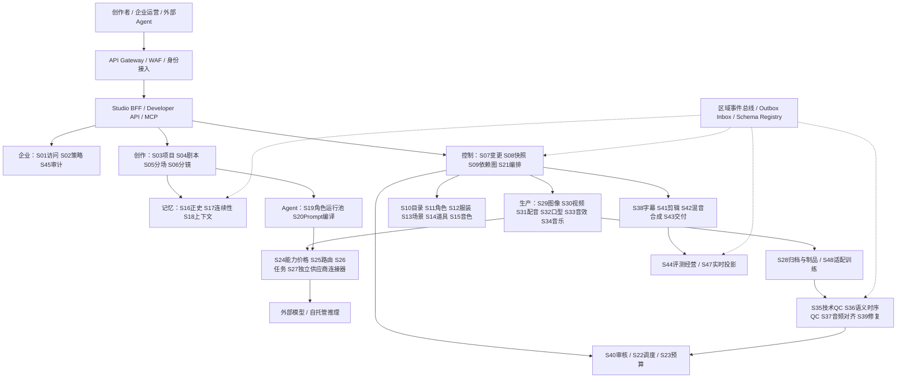

# 01 · 企业架构与服务边界

## 1. 产品与业务域

平台支持单企业多团队、多项目、多集、多分支的大规模短剧生产。业务主对象为Tenant → Organization → Project/Series → Episode → Scene → Shot → Revision/Artifact。拍摄顺序、故事时间、剧集发行顺序、模型执行顺序分别记录，不能用同一序号代替。

业务域拆为企业治理、创作、资产、记忆、Agent、生产控制、模型、执行、媒体、质量、后期、交付和经营分析。48个独立服务详见02与services；每个服务控制自己的写入和迁移，按故障域与业务事实划界。

图中的域是便于阅读的分组，组内服务有独立Deployment、ServiceAccount、数据库写身份与发布版本；不把域分组实现成另一个大服务。API Gateway、BFF、Studio独立部署但不拥有核心生产事实。

## 2. 服务独立的定义

每个服务具备：稳定服务ID、负责团队、专属schema/database、命令与查询契约、事件、幂等与并发规则、SLO、限流、资源池、独立CI/CD、回滚和恢复手册。独立不等于每个函数一个进程；无状态库作为SDK共享，角色/供应商隔离通过不同Deployment运行相同镜像。

普通规模的多个服务可使用同一托管Postgres集群的不同database与角色，禁止跨库写入和JOIN；高负载与敏感服务独享集群。S08版本、S16记忆、S23账本优先物理隔离。数据库故障域不能被“逻辑独立”掩盖。

全域只共享primitive契约、认证中间件、trace/metrics、事件SDK和幂等框架。禁止共享包含业务ORM和写逻辑的domain包；跨服务规则通过契约/Saga实现。

## 3. 唯一权威与职责分离

| 事实 | 唯一写所有者 | 其他服务如何使用 |
|---|---|---|
| 当前生产manifest、接受指针、epoch、锁 | S08 | 请求CAS提交；消费事件构建投影 |
| 剧本/分镜内容版本 | S04/S06 | manifest引用不可变版本 |
| 资产内容与canonical版本 | S11–S15 | S10保留索引与绑定；不复制权威资产字段 |
| 正史事实/状态/关系/伏笔 | S16 | S18构建上下文；S17只做检查 |
| 预算余额/预留/实际费用 | S23 | S26凭授权提交；S44读投影 |
| 供应商并发/速率permit | S22 | 所有模态与训练共用账户池上限 |
| 生成任务与未知提交 | S26 | S27提供供应商观测，不另建任务状态真相 |
| 制品bytes、hash、存储位置 | S28 | 业务域只保存artifact_id和内容hash |
| 人工决定 | S40 | 决定经S02校验后由S08改变接受指针 |
| 工作流执行history | Temporal | S21保留业务投影，不自建另一套执行状态机 |

## 4. 企业ADR

- EADR-001取代ADR-001的部署部分：多Agent创作与Temporal执行职责保留，业务服务全独立部署。
- EADR-002取代旧共享PG方案：database-per-service逻辑隔离，按cell与敏感级别进一步物理隔离。
- EADR-003：事件总线选Kafka兼容平台，默认区域内部署；与Temporal Task Queue分工明确。
- EADR-004：租户和每个Run单home-cell、单写者；跨地域并行付费提交必须有可验证的防重能力，否则停止。
- EADR-005：跨服务接受通过不可变内容+S08 manifest CAS；预算与配额通过有补偿的Admission Saga；无跨库事务假设。
- EADR-006：跨集记忆为一等业务域，不能用聊天记录或向量库替代正史。
- EADR-007：自动化档位、生成门、接受门分开；预算与权限硬约束优先。
- EADR-008：各Agent角色、供应商渠道和GPU作业分别资源隔离；一个故障不能占满全部租户容量。

## 5. 技术基线

Kubernetes+GitOps/Helm；企业现有平台优先。FastAPI/Python实现创作与模型服务、Temporal Python SDK；高吞吐边缘可采用团队已有Go/JVM栈，禁止为了拆分复制一整套语言体系。Next.js/React工作台；OpenAPI3.1+JSON Schema2020-12；服务内部可选gRPC，消息采用CloudEvents风格的JSON契约。Postgres权威OLTP、Kafka事件、S3兼容媒体、Redis缓存、独立搜索/向量索引、OLAP报表、OpenTelemetry观测。图查询首期可由S09的Postgres边表实现，达到量级后内部替换图引擎，不改变外部契约。
