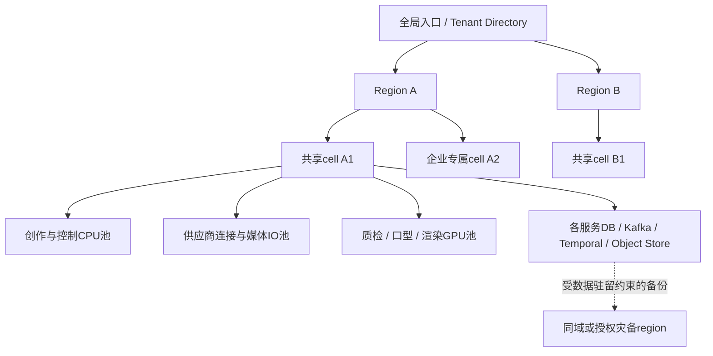

# 03 · 部署拓扑、容量与隔离

## 1. 全局控制面与地域cell

全局控制面保存Tenant Directory、home_region/home_cell、身份联邦配置和不含敏感内容的服务目录。剧本、媒体、音色、记忆、任务与账本位于租户被分配的地域cell。全球访问先做租户解析再路由，客户端不能任意指定其他cell越权。

每cell含：独立服务部署、Temporal namespace/worker队列、事件topic空间、服务数据库集群、对象存储前缀与密钥、Redis、索引、可观测采集。通用cell多租户逻辑隔离；高等级企业可专属namespace、专属数据集群或整个专属cell。

Kubernetes requests/limits、ResourceQuota、NetworkPolicy、PodDisruptionBudget和独立ServiceAccount按服务配置。在线控制、生成连接、媒体转码、VLM、训练分别node pool；训练不允许挤占在线推理保底容量。外部API调用量由S22约束，增加Worker不提升供应商合同配额。

## 2. 规划参考量级（非实测承诺）

| 参数 | 参考值 |
|---|---:|
| 注册企业租户 | 1,000 |
| 用户席位 / 峰值在线用户 | 20,000 / 2,000 |
| 同时活跃Run | 5,000 |
| 每日镜头任务 | 500,000 |
| 每镜头平均视频业务attempt | 1.8 |
| 每attempt生成长度 / 平均供应商在途时间 | 5秒 / 300秒 |
| 峰均比 / 容量余量 | 5 / 1.3 |
| 生成视频平均码率 | 8Mbps |

视频请求=900,000次/日，平均10.42次/秒，峰值52.08次/秒。Little定律估算：平均在途3,125个，峰值15,625个，按1.3余量约20,313个。它是跨供应商在途任务目标，绝不等于20,313个自托管GPU。

每日生成视频4,500,000秒，8Mbps按十进制约4.5TB/日，30日原始视频约135TB，尚未含图片、音频、代理、渲染、备份、冗余和跨地域复制。每镜头4秒可用时长的假设下，每日成片约33,333分钟；这也需要真实可用率与返工样本验证。

所有模态的请求总量、视频VLM分析秒数、音频对齐、图像候选、用户下载与峰值SSE连接另外预算。容量配置与计算在examples/capacity-plan.json，可调整后重新计算，不能直接拿规划值承诺客户。

## 3. 分片与热点

- 生产事实按tenant/project归home-cell，单集manifest CAS按episode+branch串行；大租户可将不同series分配不同cell，但同一series记忆的权威写入仍单home-cell。
- Kafka按aggregate_id维持聚合内顺序；记忆series热点可分对象流，并用显式commit序列形成consistent checkpoint。
- S22按provider+account+region形成quota pool，额度不可被租户分片重复计算。超大共享账户池可委派有严格上限的子permit，总额不变。
- S23多级预算先锁tenant/project/episode等预算行并固定锁序；高频细粒度任务可预分配有限escrow到Run，父级outstanding总额含已委派额度，禁止父子重复消费。
- 大媒体采用multipart、断点hash与就近归档；对象前缀包含tenant、region、series、artifact而不依赖可变显示名。

## 4. 服务等级与弹性

目标示例：控制API可用性99.95%，普通读P95≤500ms、受理命令P95≤1s，均排除LLM/模型执行；高代价规划返回operation。事件投影正常P95≤5s，SSE重连可恢复。生成完成时长按模型/规格给分位数，供应商服务中断不隐藏在API可用性里。

HPA/KEDA按队列最老等待时间、有效待处理量、CPU/GPU和连接数伸缩；同时设max replicas、预算、账户额度和存储水位。背压顺序：限制低优先级新Run → 减少候选并发（不改已约定质量）→ 等待容量；不丢必要节点或静默降画质。

供应商配额与客户峰值差距要在采购和准入阶段暴露；不可实现的deadline返回预计窗口与可选范围。容量验收使用模拟供应商做平台压测，真实供应商仅在明确测试预算与配额下验证。
