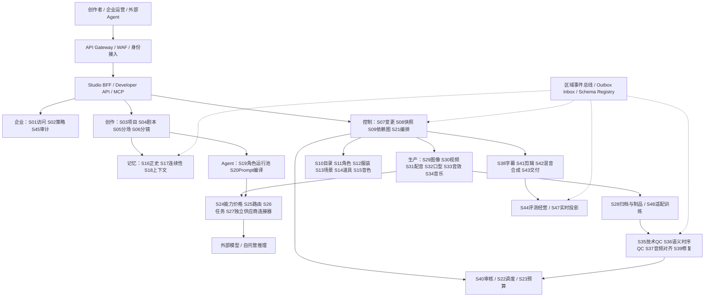
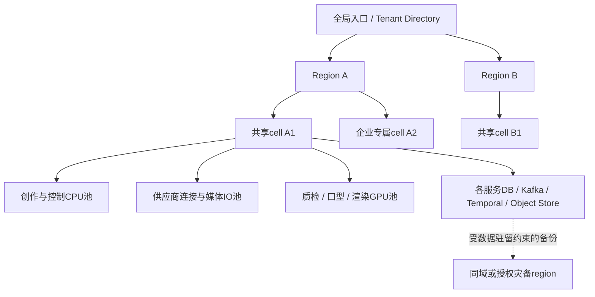

# 企业级短剧生产平台 · 架构 v2

设计日期：2026-10-29（Asia/Taipei）。阶段：设计交接，未实现/部署业务服务，未调用付费生成模型。此版本取代v0.1的模块化单体、共享业务数据库、10集并发假设和粗粒度模块边界。

产品目标：让企业团队与外部Agent在固定质量、授权、预算与交付要求下，进行跨集连续短剧的创作、生成、审片、修改和批量交付。衡量每可用成片分钟成本、交付周期、成片可用率与人工投入。

## 本次全面升级

- **48个独立业务服务**：每个服务有独立数据所有权、部署单元、命令/查询、事件、扩缩容、故障恢复与验收；共享的是基础框架和契约，不共享可写业务模型。
- **完整跨集记忆域**：正史、事件、人物状态/关系/知情范围、伏笔、故事时间和分支；记忆与检索、连续性校验分别独立。
- **四档人工参与**：逐步制作、阶段审核、异常接管、无人值守；项目/集/阶段/节点覆盖，生成与接受分开，权限/授权/预算硬约束不可绕过。
- **大规模运行**：全局控制面+地域cell执行面，租户单home-cell、队列隔离、公平调度、供应商在途配额、成本准入Saga、重放与灾备。
- **企业治理**：SSO/OIDC/SAML适配、组织/项目权限、服务身份、专属租户部署、数据驻留、审计、BYOK凭证、保留与删除。
- **完整交付契约**：服务目录、v2 JSON Schema、核心OpenAPI设计、事件Topic目录、流程样例、自动化策略、容量计算、实施与验收矩阵。

## 入口与阅读顺序

1. [总文档](DESIGN.md)：所有架构章节合并，便于交接。
2. [企业架构总览](../../docs/01-enterprise-architecture.md)与[48服务目录](../../docs/02-service-catalog.md)。
3. [部署与容量](../../docs/03-deployment-capacity.md)、[数据与分布式事务](../../docs/04-data-consistency.md)。
4. [跨集记忆](../../docs/05-cross-episode-memory.md)、[人工参与分层](../../docs/06-automation-governance.md)。
5. [生产主流程](../../docs/07-production-workflows.md)、[Agent与Prompt](../../docs/08-agents-prompts.md)、[模型与任务](../../docs/09-model-execution.md)。
6. [资产域](../../docs/10-assets.md)、[质量域](../../docs/11-quality-repair.md)、[成本与调度](../../docs/12-budget-scheduling.md)。
7. [API与工作台](../../docs/13-api-product.md)、[企业治理与容灾](../../docs/14-enterprise-operations.md)。
8. [业务交付与评测](../../docs/15-fde-business-evaluation.md)、[迁移实施与验收](../../docs/16-migration-acceptance.md)。

`services/`：每个服务一份独立边界规格。`contracts/`：机器可读契约。`examples/`：策略、事件、场景与容量样例。`diagrams/`：Mermaid源图。`layout.html`：企业工作台静态布局。`VALIDATION.md`：静态检查范围与结果。

快速审阅：[升级摘要](UPGRADE.md) · [独立服务规格汇编](SERVICE-SPECIFICATIONS.md) · [企业工作台布局](../../apps/studio-web/layout.html) · [验证记录](VALIDATION.md) · [文件校验清单](MANIFEST.md)。

## 与旧版的关系

v0.1中的ShotSpec、GenerationRequest、QCReport作为[领域负载基线](../../contracts/domain-v1/README.md)保留，外包v2租户/分支/cell/manifest/epoch/授权上下文；不得继续采用旧版单体部署、全局共享业务DB或只靠episode_revision覆盖并发。

Sora/Veo等系列保留连接器位置，当前渠道可用性以实施时的官方生命周期与账户探测为准。旧版已核查的停用端点继续禁用，不借本次架构升级声称模型已经恢复。所有供应商生产开关默认关闭。

## 设计与实现边界

容量、SLO、RPO/RTO均是待基准测试和商业配额验证的规划值。该包没有可运行微服务、真实密钥或供应商能力认证，不是已完成的企业系统。48个边界可以分波次交付，但生产边界从第一波就遵循独立数据和契约规则。


---

# 01 · 企业架构与服务边界

## 1. 产品与业务域

平台支持单企业多团队、多项目、多集、多分支的大规模短剧生产。业务主对象为Tenant → Organization → Project/Series → Episode → Scene → Shot → Revision/Artifact。拍摄顺序、故事时间、剧集发行顺序、模型执行顺序分别记录，不能用同一序号代替。

业务域拆为企业治理、创作、资产、记忆、Agent、生产控制、模型、执行、媒体、质量、后期、交付和经营分析。48个独立服务详见02与services；每个服务控制自己的写入和迁移，按故障域与业务事实划界。



图中的域是便于阅读的分组，组内服务有独立Deployment、ServiceAccount、数据库写身份与发布版本；不把域分组实现成另一个大服务。API Gateway、BFF、Studio独立部署但不拥有核心生产事实。

## 2. 服务独立的定义

每个服务具备：稳定服务ID、负责团队、专属schema/database、命令与查询契约、事件、幂等与并发规则、SLO、限流、资源池、独立CI/CD、回滚和恢复手册。独立不等于每个函数一个进程；无状态库作为SDK共享，角色/供应商隔离通过不同Deployment运行相同镜像。

普通规模的多个服务可使用同一托管Postgres集群的不同database与角色，禁止跨库写入和JOIN；高负载与敏感服务独享集群。S08版本、S16记忆、S23账本优先物理隔离。数据库故障域不能被“逻辑独立”掩盖。

全域只共享primitive契约、认证中间件、trace/metrics、事件SDK和幂等框架。禁止共享包含业务ORM和写逻辑的domain包；跨服务规则通过契约/Saga实现。

## 3. 唯一权威与职责分离

| 事实 | 唯一写所有者 | 其他服务如何使用 |
|---|---|---|
| 当前生产manifest、接受指针、epoch、锁 | S08 | 请求CAS提交；消费事件构建投影 |
| 剧本/分镜内容版本 | S04/S06 | manifest引用不可变版本 |
| 资产内容与canonical版本 | S11–S15 | S10保留索引与绑定；不复制权威资产字段 |
| 正史事实/状态/关系/伏笔 | S16 | S18构建上下文；S17只做检查 |
| 预算余额/预留/实际费用 | S23 | S26凭授权提交；S44读投影 |
| 供应商并发/速率permit | S22 | 所有模态与训练共用账户池上限 |
| 生成任务与未知提交 | S26 | S27提供供应商观测，不另建任务状态真相 |
| 制品bytes、hash、存储位置 | S28 | 业务域只保存artifact_id和内容hash |
| 人工决定 | S40 | 决定经S02校验后由S08改变接受指针 |
| 工作流执行history | Temporal | S21保留业务投影，不自建另一套执行状态机 |

## 4. 企业ADR

- EADR-001取代ADR-001的部署部分：多Agent创作与Temporal执行职责保留，业务服务全独立部署。
- EADR-002取代旧共享PG方案：database-per-service逻辑隔离，按cell与敏感级别进一步物理隔离。
- EADR-003：事件总线选Kafka兼容平台，默认区域内部署；与Temporal Task Queue分工明确。
- EADR-004：租户和每个Run单home-cell、单写者；跨地域并行付费提交必须有可验证的防重能力，否则停止。
- EADR-005：跨服务接受通过不可变内容+S08 manifest CAS；预算与配额通过有补偿的Admission Saga；无跨库事务假设。
- EADR-006：跨集记忆为一等业务域，不能用聊天记录或向量库替代正史。
- EADR-007：自动化档位、生成门、接受门分开；预算与权限硬约束优先。
- EADR-008：各Agent角色、供应商渠道和GPU作业分别资源隔离；一个故障不能占满全部租户容量。

## 5. 技术基线

Kubernetes+GitOps/Helm；企业现有平台优先。FastAPI/Python实现创作与模型服务、Temporal Python SDK；高吞吐边缘可采用团队已有Go/JVM栈，禁止为了拆分复制一整套语言体系。Next.js/React工作台；OpenAPI3.1+JSON Schema2020-12；服务内部可选gRPC，消息采用CloudEvents风格的JSON契约。Postgres权威OLTP、Kafka事件、S3兼容媒体、Redis缓存、独立搜索/向量索引、OLAP报表、OpenTelemetry观测。图查询首期可由S09的Postgres边表实现，达到量级后内部替换图引擎，不改变外部契约。


---

# 独立服务目录

48个业务服务边界；Gateway、BFF、Studio与托管基础设施另外独立部署。每个链接均有职责、数据、命令、事件、扩容、故障与专项验收。

| ID | 服务 | 域 | 数据所有者schema | 负责团队 |
|---|---|---|---|---|
| S01 | [租户与访问](../../services/tenant-access/service.md) | enterprise | `tenant_access` | platform |
| S02 | [治理与自动化策略](../../services/governance-policy/service.md) | enterprise | `governance_policy` | platform |
| S03 | [项目与剧集目录](../../services/project-catalog/service.md) | creation | `project_catalog` | creation |
| S04 | [创意与剧本](../../services/narrative/service.md) | creation | `narrative` | creation |
| S05 | [分集分场](../../services/breakdown/service.md) | creation | `breakdown` | creation |
| S06 | [分镜与导演规范](../../services/storyboard/service.md) | creation | `storyboard` | creation |
| S07 | [对话修改与变更计划](../../services/change-management/service.md) | control | `change_management` | workflow |
| S08 | [版本快照与接受状态](../../services/revision-snapshot/service.md) | control | `revision_snapshot` | workflow |
| S09 | [依赖溯源与影响分析](../../services/lineage-impact/service.md) | control | `lineage_impact` | workflow |
| S10 | [资产目录与绑定解析](../../services/asset-catalog/service.md) | assets | `asset_catalog` | assets |
| S11 | [角色身份资产](../../services/character-assets/service.md) | assets | `character_assets` | assets |
| S12 | [服装与妆造资产](../../services/costume-assets/service.md) | assets | `costume_assets` | assets |
| S13 | [场景与空间资产](../../services/scene-assets/service.md) | assets | `scene_assets` | assets |
| S14 | [道具资产](../../services/prop-assets/service.md) | assets | `prop_assets` | assets |
| S15 | [音色与声音授权](../../services/voice-assets/service.md) | assets | `voice_assets` | assets |
| S16 | [跨集记忆与正史](../../services/story-memory/service.md) | memory | `story_memory` | memory |
| S17 | [连续性校验](../../services/continuity/service.md) | memory | `continuity` | memory |
| S18 | [上下文检索与组装](../../services/context-retrieval/service.md) | memory | `context_retrieval` | memory |
| S19 | [Agent运行与工具沙箱](../../services/agent-runtime/service.md) | agents | `agent_runtime` | agents |
| S20 | [Prompt模板与编译](../../services/prompt-compiler/service.md) | agents | `prompt_compiler` | agents |
| S21 | [长任务编排](../../services/orchestration/service.md) | control | `orchestration` | workflow |
| S22 | [调度与供应商配额](../../services/scheduler-quota/service.md) | execution | `scheduler_quota` | execution |
| S23 | [预算与成本账本](../../services/budget-ledger/service.md) | finance | `budget_ledger` | finance |
| S24 | [模型能力与价格注册](../../services/model-registry/service.md) | models | `model_registry` | models |
| S25 | [模型路由与估价](../../services/model-routing/service.md) | models | `model_routing` | models |
| S26 | [统一生成任务协调](../../services/generation-jobs/service.md) | execution | `generation_jobs` | execution |
| S27 | [供应商连接器](../../services/provider-connectors/service.md) | execution | `provider_connectors` | execution |
| S28 | [素材归档与制品目录](../../services/artifact-ingest/service.md) | media | `artifact_ingest` | media |
| S29 | [图像与关键帧生产](../../services/image-production/service.md) | production | `image_production` | generation |
| S30 | [视频片段生产](../../services/video-production/service.md) | production | `video_production` | generation |
| S31 | [配音生产](../../services/speech-production/service.md) | production | `speech_production` | generation |
| S32 | [口型生产](../../services/lipsync/service.md) | production | `lipsync` | generation |
| S33 | [音效生产](../../services/sound-effects/service.md) | production | `sound_effects` | generation |
| S34 | [BGM与音乐](../../services/music/service.md) | production | `music` | generation |
| S35 | [媒体技术质检](../../services/technical-qc/service.md) | quality | `technical_qc` | quality |
| S36 | [视觉语义与时序质检](../../services/semantic-qc/service.md) | quality | `semantic_qc` | quality |
| S37 | [音频理解与对齐质检](../../services/audio-alignment/service.md) | quality | `audio_alignment` | quality |
| S38 | [字幕与本地化](../../services/subtitles/service.md) | post | `subtitles` | post |
| S39 | [返工与修复决策](../../services/repair-planning/service.md) | quality | `repair_planning` | quality |
| S40 | [人工审核与接管](../../services/human-review/service.md) | governance | `human_review` | platform |
| S41 | [剪辑与时间线](../../services/editorial/service.md) | post | `editorial` | post |
| S42 | [混音与合成渲染](../../services/composition/service.md) | post | `composition` | post |
| S43 | [交付与外部分发](../../services/delivery/service.md) | post | `delivery` | post |
| S44 | [效果评测与经营分析](../../services/evaluation-analytics/service.md) | analytics | `evaluation_analytics` | data |
| S45 | [审计与证据保全](../../services/audit/service.md) | enterprise | `audit` | platform |
| S46 | [开发者API与MCP](../../services/developer-integration/service.md) | experience | `developer_integration` | experience |
| S47 | [实时状态与通知投影](../../services/realtime-projection/service.md) | experience | `realtime_projection` | experience |
| S48 | [LoRA与模型适配训练](../../services/adaptation-training/service.md) | assets | `adaptation_training` | assets |


---

# 03 · 部署拓扑、容量与隔离

## 1. 全局控制面与地域cell

全局控制面保存Tenant Directory、home_region/home_cell、身份联邦配置和不含敏感内容的服务目录。剧本、媒体、音色、记忆、任务与账本位于租户被分配的地域cell。全球访问先做租户解析再路由，客户端不能任意指定其他cell越权。

每cell含：独立服务部署、Temporal namespace/worker队列、事件topic空间、服务数据库集群、对象存储前缀与密钥、Redis、索引、可观测采集。通用cell多租户逻辑隔离；高等级企业可专属namespace、专属数据集群或整个专属cell。



Kubernetes requests/limits、ResourceQuota、NetworkPolicy、PodDisruptionBudget和独立ServiceAccount按服务配置。在线控制、生成连接、媒体转码、VLM、训练分别node pool；训练不允许挤占在线推理保底容量。外部API调用量由S22约束，增加Worker不提升供应商合同配额。

## 2. 规划参考量级（非实测承诺）

| 参数 | 参考值 |
|---|---:|
| 注册企业租户 | 1,000 |
| 用户席位 / 峰值在线用户 | 20,000 / 2,000 |
| 同时活跃Run | 5,000 |
| 每日镜头任务 | 500,000 |
| 每镜头平均视频业务attempt | 1.8 |
| 每attempt生成长度 / 平均供应商在途时间 | 5秒 / 300秒 |
| 峰均比 / 容量余量 | 5 / 1.3 |
| 生成视频平均码率 | 8Mbps |

视频请求=900,000次/日，平均10.42次/秒，峰值52.08次/秒。Little定律估算：平均在途3,125个，峰值15,625个，按1.3余量约20,313个。它是跨供应商在途任务目标，绝不等于20,313个自托管GPU。

每日生成视频4,500,000秒，8Mbps按十进制约4.5TB/日，30日原始视频约135TB，尚未含图片、音频、代理、渲染、备份、冗余和跨地域复制。每镜头4秒可用时长的假设下，每日成片约33,333分钟；这也需要真实可用率与返工样本验证。

所有模态的请求总量、视频VLM分析秒数、音频对齐、图像候选、用户下载与峰值SSE连接另外预算。容量配置与计算在examples/capacity-plan.json，可调整后重新计算，不能直接拿规划值承诺客户。

## 3. 分片与热点

- 生产事实按tenant/project归home-cell，单集manifest CAS按episode+branch串行；大租户可将不同series分配不同cell，但同一series记忆的权威写入仍单home-cell。
- Kafka按aggregate_id维持聚合内顺序；记忆series热点可分对象流，并用显式commit序列形成consistent checkpoint。
- S22按provider+account+region形成quota pool，额度不可被租户分片重复计算。超大共享账户池可委派有严格上限的子permit，总额不变。
- S23多级预算先锁tenant/project/episode等预算行并固定锁序；高频细粒度任务可预分配有限escrow到Run，父级outstanding总额含已委派额度，禁止父子重复消费。
- 大媒体采用multipart、断点hash与就近归档；对象前缀包含tenant、region、series、artifact而不依赖可变显示名。

## 4. 服务等级与弹性

目标示例：控制API可用性99.95%，普通读P95≤500ms、受理命令P95≤1s，均排除LLM/模型执行；高代价规划返回operation。事件投影正常P95≤5s，SSE重连可恢复。生成完成时长按模型/规格给分位数，供应商服务中断不隐藏在API可用性里。

HPA/KEDA按队列最老等待时间、有效待处理量、CPU/GPU和连接数伸缩；同时设max replicas、预算、账户额度和存储水位。背压顺序：限制低优先级新Run → 减少候选并发（不改已约定质量）→ 等待容量；不丢必要节点或静默降画质。

供应商配额与客户峰值差距要在采购和准入阶段暴露；不可实现的deadline返回预计窗口与可选范围。容量验收使用模拟供应商做平台压测，真实供应商仅在明确测试预算与配额下验证。


---

# 04 · 数据所有权、事件与分布式一致性

## 1. 标准身份与版本

每条命令携带command_id、tenant_id、project/series、branch、home_cell、manifest_ref、epoch、trace_id、actor/service principal、目的与预算scope。tenant/actor从认证派生，header不能自授身份。service-to-service用mTLS/workload identity，授权上下文绑定请求hash与audience。

内容对象immutable；revision整数只在对象内有意义，跨服务以`service/id/revision/content_hash`定位。S08保存manifest，将各服务内容引用拼成一致的生产视图，并以manifest_revision和epoch做CAS。各服务之间不要求同时提交数据库。

epoch分两层：Run/branch的execution_fence用于取消或主写切换；每个logical_node的node_epoch用于局部生成版本。改一个镜头只提升受影响节点的node_epoch，不使其他在途镜头全部过期。S08接入结果时检查node_epoch、input_fingerprint、asset/memory/policy引用和execution_fence；若仅其他镜头改变manifest，可基于最新manifest重新CAS合并本节点，不覆盖其他指针。manifest_ref是溯源和并发基础，不能单凭“不是最新manifest”丢掉所有无关任务。

## 2. 修改与接受Saga

S07生成计划，S09验证影响闭包，S02验证规则 → 各内容所有者准备新revision（未接受） → S08原子提交manifest+epoch+Outbox → S21消费事件调度新子图。S08提交失败时准备产物保持unreferenced，可在保留期后GC；不回滚已经提交的事实为“原地旧值”。

关键前置版本在S08 commit时再次校验；ChangePlan包含base_manifest、source hashes、derived adjustments、impact_watermark、policy_version、memory_checkpoint与expiry。依赖索引落后时先补齐必需边或保守重检，不能按不完整图承诺局部失效。

接受候选：S35–S37的QC report引用同一artifact hash；S40人工决定引用同一manifest/epoch；S02判定接受门；S08 CAS更新accepted pointer。S40不写S08数据库，QC服务也不能自动改全剧资产canonical。

## 3. 预算与配额准入Saga

1. S26固定attempt_id、request_hash、报价上界；请求S23创建预算reservation。
2. S22按预算reservation和路由账户池申请permit；失败补偿释放尚未提交的reservation。
3. 两者成功后S26持久化SubmissionIntent+Outbox，绑定token、permit、报价、epoch、执行fence。
4. S27执行器在付费前调用S26的dispatch授权；S26幂等确认S23资金仍已授权、S22 permit转为submitted/inflight，双方返回持久ack后签发绑定request_hash的一次性dispatch grant。
5. 任一ack不明时不提交，继续恢复Saga；已有submitted permit与reservation不按普通TTL回收。
6. 调用结果不明进入SUBMISSION_UNKNOWN，保持费用与在途占用，查询/对账后决定；不将网络重试当免费安全操作。
7. 权威终态后S23暂记/对账实际费用、释放剩余预留，S22释放在途permit。每一步有唯一业务事件键，重复投递无重复扣减。

这是一组可恢复的本地事务与补偿，不宣称跨DB原子事务。供应商不支持幂等时，dispatch grant只允许一个fenced执行器领取一次；领取后崩溃产生未知提交，不重新领取同任务自动重发。供应商侧exactly-once不能由本平台单方面保证。

## 4. 事件标准

区域Kafka兼容总线；事件envelope采用CloudEvents1.0字段加领域上下文：id/source/type/subject/time/specversion、schema_version、tenant/home_cell、aggregate_id/sequence、correlation_id/causation_id、traceparent、data、data_ref（可选大负载引用）。Topic目录见contracts/event-topics.v2.json。

Outbox与本地事实同事务；CDC或publisher至少一次投递。消费者Inbox按consumer+event_id去重；聚合sequence缺口可缓冲并回源，不能无限等待；状态终态不得被旧事件倒退。回放使用独立consumer group和side_effects=false，避免重发外部消息、费用调用或发布。

事件正常保留示例14日，长期事实恢复靠service snapshots+授权归档，不把Kafka唯一当永久账本。财务/审计保留期由客户合同和地区规则配置。DLQ携带错误分类、重试次数、原引用与重放权限；告警与运营队列可见。

Schema Registry执行兼容规则；字段新增为可选，变语义/删除走新major topic/schema，双读双写迁移有结束时间。媒体bytes、克隆音频、密钥和完整剧本不放普通事件，使用权限化data_ref。

## 5. 事件最终一致性的可见性

每个投影返回watermark与source_revision。需要强一致的余额、当前manifest、音色授权、正史checkpoint回源权威服务。S47页面不能把旧进度显示成当前已完成；S18不能把尚未投影的记忆当不存在。

读到未提交候选只可用于预览，必须带candidate标记。最终交付的证据包固定manifest+memory checkpoint+asset bindings+QC+政策+成本时间点，确保后续重算和审计可解释。

## 6. 生命周期与删除

S28内容hash去重只在租户/授权边界内进行，禁止通过跨租户hash存在性泄漏素材。删除按引用图、法律保留、发布引用和训练引用检查；先tombstone禁用新调用，再按服务编排删除/索引清除/备份到期清除。审计与财务记录可保留最小证明，不保留被删除媒体原文。密钥销毁是否满足删除要求由部署政策定义并验证。


---

# 05 · 完整跨集记忆域

## 1. 三个独立服务

S16 Story Memory持有正史；S18 Context Retrieval负责权限与时间过滤后的检索、组装；S17 Continuity负责发现逻辑/视觉/声音连续性冲突。S09保留记忆声明到上下文、剧本、镜头、成片的依赖。S19中的记忆抽取Agent只是受约束计算任务，无权把草稿直接写成正史。

## 2. 记忆数据与时间

| 类型 | 内容 | 关键字段 |
|---|---|---|
| WorldRule | 世界规则、年代、不可违反设定 | rule_id、scope、exceptions |
| CharacterProfile | 人物背景、性格、目标、能力 | entity_id、profile_revision |
| StoryEvent | 发生事件、参与者、因果 | event_id、participants、causes、story_time |
| EntityState | 伤势、服装状态、道具归属、位置 | entity_id、predicate、value、valid interval |
| Relationship | 信任、亲属、敌对、债务 | subject/object、relation、valid interval |
| KnowledgeState | 谁知道/相信/误解哪个命题 | knower_id、claim_id、belief_type、reveal_event |
| PlotThread | 伏笔、悬念、目标、回收条件 | thread_id、open/advanced/resolved、due_story_range |
| EpisodeSummary | 接受剧本与成片的分层摘要 | episode_manifest_ref、intent/observed、claim_refs |
| CreativePreference | 导演偏好与已接受例外 | owner/scope、explicit/inferred、expiry |
| CanonBranch | 正史分支、实验改稿与分叉 | branch_id、parent_checkpoint、merge_status |

双时间：valid_story_time记录故事中何时成立，recorded_at/commit_sequence记录系统何时知道。另有episode_order、audience_reveal_scope、character_knowledge_scope，分别解决闪回、先拍后播、观众已知而角色未知等问题。不可仅按created_at取最新。

Claim带稳定ID、不可变revision、subject/predicate/object、来源service/id/revision/hash、source_kind、branch、accepted_manifest、valid_from/to、supersedes、confidence与review状态。记忆只包含可证据化声明；推测保存candidate，不能与accepted事实混用。

## 3. 写入与正式接受

剧本新版本 → 抽取candidate claims → 结构规则/冲突检查 → 按项目模式人工或自动接受剧本 → S08发布manifest accepted事件 → S16核验来源并原子提交MemoryCommit → 发布canon.committed → S18/S09推进索引与依赖水位。

S16 commit按series+branch序列化，提供expected_checkpoint做CAS；提交批次中必须含完整来源。重复接受事件不重复生成事实。剧本意图与成片观测分层存储：成片中道具错误不直接覆盖剧本正史，形成continuity defect与待决策冲突。合法即兴改动要经过明确接受事件才更新正史。

节点可用的上下文由`memory_checkpoint + source_manifest_set + branch`固定。后续集生成前声明required canon checkpoint；投影未达到时等候/回源，不能凭“检索没找到”认定事实不存在。

## 4. 检索与Agent上下文

输入：租户/series/branch、目标episode、故事时间区间、角色集合、角色视角或全知视角、任务类型、token预算、最低checkpoint。

过滤顺序：认证与项目权限 → 分支与接受状态 → 故事有效期 → 信息揭示/角色知情限制 → 相关性检索 → 冲突标记 → 摘要。硬事实用结构化查询；语义检索用于关联背景与伏笔。向量库/全文索引均可重建，非事实源。

ContextPack返回fact refs、plot thread refs、asset refs、prohibited assumptions、unresolved conflicts、source watermark、token usage和hash。输入事实来自不可信文本时按数据封装，不允许“记忆里写了忽略预算”改变工具权限。

编剧包偏向人物关系和伏笔；分镜包偏向动作、道具与空间；Prompt包偏向身份与可见状态；QC包包含预期状态与允许例外。不能把整剧全部文本无界传给每次模型调用。

只读检索/预览只组装已有事实和已生成摘要，不隐式发起付费推理。需要新摘要或复杂推理时提交显式plan:compute任务，经S19/S26预算准入后保存版本，再供检索读取。

## 5. 改前集、分支与记忆失效

例：第2集原来“林岚左手受伤，将钥匙交陈默，仍不知道陈默身份”。第3集应保持伤势、钥匙归属和知情边界。

若第2集改为“藏起钥匙”，S07提交新剧本manifest；S16创建superseding claims与新checkpoint；S09沿claim→context_pack→script→shot→artifact依赖定位后续集。计划区分必须改剧情、仅重做QC、可复用资产。未明确迁移前，已交付集保留原checkpoint和历史证据，不悄悄重写。

改稿分支采用copy-on-write引用父checkpoint，实验分支事实不污染正史。合并输出冲突清单（同一谓词相同valid interval的不同值、互斥事件、因果破坏、重复回收伏笔），由规则或有权限人工裁决。回滚追加新commit，不删除历史claim。

## 6. 记忆专项验收

必须覆盖跨3集状态、角色知情范围、观众先知、误导性对白、闪回、时间跳跃、候选未接受、前集改稿传播、分支隔离与合并、索引滞后、重复事件、记忆抽取幻觉与来源撤销。自动化模式也不能允许无证据推测成为accepted正史。


---

# 06 · 人工参与分层与企业治理

## 1. 四档产品模式

| mode | 行为 | 等待与失败处理 |
|---|---|---|
| guided | 用户逐节点启动，节点内部自动执行 | 完成后等待下一明确命令；仍可预生成获授权的独立准备分支 |
| stage_review | 阶段自动，配置关口人工接受 | 默认剧本/角色canonical/关键分镜/粗剪/最终交付门；关口可按项目选择 |
| exception_assisted | 连续生成、自动QC和有界修复 | 低置信度、冲突、预算不足、修复耗尽时创建人审任务并等待相关分支 |
| unattended_batch | 按预设策略自动选候选、返工、合成 | 无法解决的必要分支标blocked，继续独立分支；Run可结束INCOMPLETE并产失败报告，不伪造成片成功 |

四档影响的是交互策略；权限、授权、数据驻留、预算、质量最低标准是硬规则。guided并不免除审计；unattended不意味着允许删对白、换音色或扩大预算。

## 2. 策略继承与可覆盖边界

企业强制策略 → 项目默认 → 单集/Run覆盖 → 阶段覆盖 → 节点覆盖。低层只能在企业允许范围内提高或调整创作自动化；企业要求的审批、法定保留与预算权限不能被覆盖。resolve输出effective_policy与每字段来源，界面可解释“为什么需要人工”。

独立字段：generation_mode（manual/auto）、acceptance_mode（manual/auto_if_qc_pass）、gate、locked、allowed_actions、repair_limits、budget_scope、reviewer_roles、exception_behavior、expiry、policy_version。自动生成多个候选后等人选、自动选后等人确认正式交付均可配置。

## 3. 门与决定

门类型：创作接受、资产canonical、质量例外、预算增加、音色/资产资格、外部分发。决定权限分开：导演可以接受创作，不自动拥有提高预算权限；财务批准额度不等于批准画面质量。

ReviewTask固定manifest/epoch、artifact hash、policy version、evidence、reason、options、assignee role和deadline。S40记录决定，S02判断权限/条件，S08最终CAS提交；过期任务、旧epoch决定返回stale，不更新当前版。多人审批可配置quorum与职责分离；同一用户重复点击算同command。

超时在guided/stage_review/exception_assisted通常WAITING_REVIEW；unattended按已配置策略隔离或失败，不自动批准。必要内容未通过时允许预览包，正式交付禁止。自动接受也记录PolicyDecision与QC证据，能追溯谁配置了规则。

## 4. 动态切换与人工接管

策略在Run开始固定。运行中切换需授权命令形成新PolicyRevision，在下一安全checkpoint应用，只影响未准入动作；已经提交供应商的任务继续对账。人工锁定节点提升epoch/lock版本，阻止自动覆盖；过期任务结果进入历史候选。

固定的是创作与自动化语义策略。账号撤销、资产/声音授权撤销、企业kill switch、数据驻留禁用和实时预算余额在每次dispatch前重新检查，不能因为Run固定旧policy而继续越权。局部修改提升受影响node_epoch，取消/灾备切主提升execution_fence；见04。

用户可在任意节点暂停、改参数、重写对白、替换媒体、选候选、分支试做、解锁。用户上传同样进行归档、权限与QC。紧急kill switch按tenant/provider/cell停止新dispatch，已有供应商任务是否可取消由渠道能力决定，未确认取消不报退款。

## 5. 产品默认

企业初次项目用stage_review，角色与风格稳定后转exception_assisted；可重复模板的批量任务使用unattended。项目创建向导直接选择四档并展示需要人工的门，单集顶栏显示当前档位，节点检查器显示继承来源。设置变更预览影响的节点和在途任务，不在运行中偷偷改默认。


---

# 07 · 企业级生产、修改与恢复流程

## 1. 整集生产

1. S46/BFF经S01鉴权，S02解析模式，S03定位项目，S08创建Run使用的manifest与epoch；API返回operation，不阻塞等待生成。
2. S18构建固定checkpoint上下文；S04/S05/S06分别执行创意剧本、分场、分镜；S19各角色池负责有界推理，输出交给各内容服务校验与保存。
3. S10解析资产与权利版本；缺资产交S11–S15/S29准备，按策略门接受canonical；S48可选训练，独立预算与GPU池。
4. S08接受剧本后S16提交正史；后续依赖集等required checkpoint。S17检查知情、状态、伏笔与视觉连续性。
5. S21扩展shot子工作流，S31配音与S37字级对齐确定对白长度，S29准备关键帧。无对白分支使用显式no-op，不创建空音频假成功。
6. S20/S25/S24完成Prompt、候选路由与能力校验，S26经S23/S22准入，由S27独立渠道执行。所有LLM/VLM和创作推理同样受预算与配额约束。
7. S28及时归档，S35/S36技术与语义时序QC；S32必要时做口型，再S37/S36检查音画与边界。失败交S39修复计划，新attempt受累计上限约束。
8. S02判定自动接受或S40审核，S08只接受当前epoch候选。S41创建EDL，S33/S34准备音效音乐，S38生成字幕，S42混音合成与标准化输出。
9. 全片QC及配置的最终门通过，S08接受master，S43生成交付包；外部分发单独授权。S44/47更新经营和实时状态；S45保存证据。

## 2. 对话局部修改

“第3场第2镜改仰拍、缩4秒”：S07用明确集上下文解析稳定shot_id → S06准备新DSL与结尾停顿派生改动 → S09按字段边找受影响子图 → S17/S37验证对白与连续性 → S25估算增量成本 → S02判断自动应用 → S08 CAS提交新manifest/epoch → S21只运行受影响子图。

重做关键帧、视频、必要口型与QC；复用未改文本/音色与足够短的TTS；重算EDL、字幕时码、音效/BGM切点、混音与master。旧任务结果归历史，实际花费仍结算。没有集上下文或4秒无法容纳对白时返回具体澄清选项，自动化档位不授权随意删台词。

## 3.跨集改稿

修改已接受的前集剧情需同时创建memory impact plan；S16的新事实checkpoint与旧manifest保留映射，S09定位后续集所依赖的claim。S07先展示跨集影响，不用修改一个字段导致全剧悄悄重做。已发布成片若不迁移，仍标记其历史canon checkpoint。

## 4. 执行层级与停止

Temporal层级为SeriesBatch → Episode → Scene/Shot → ProductionStage → ProviderJobWait/Media/QC。每层扇出上限、deadline、cancel scope与预算scope明确；过大history用子工作流和Continue-As-New，业务idempotency跨Run持久化。

Workflow纯确定性控制流，业务I/O、推理、存储、非确定时钟在Activity。Activity deadline、heartbeat与重试策略按任务类型配置；等待模型使用callback signal+持久timer对账，不在API进程sleep。

暂停停止新准入，继续已有任务归档结算；取消可取消渠道任务，其余discard_on_completion；恢复先查已存在provider_job。缺失素材/必要节点失败导致INCOMPLETE或WAITING_*，不能将其当SUCCEEDED。无人值守结束时给独立分支结果与失败清单。

## 5. 标准输出

Master/clean master、字幕SRT/VTT/ASS、对白/音效/BGM stems、EDL/Timeline JSON、资产版本manifest、Prompt/模型与政策引用、QC与审核证据、成本报告、跨集记忆checkpoint、交付完整性签名。具体编码/色彩/响度由客户项目规格确定。


---

# 08 · Agent独立运行与Prompt编译

## 1. 每个Agent角色独立交付

S19提供共用运行协议，producer、writer、breakdown、storyboard-director、asset-curator、memory-extractor、continuity-reviewer、prompt-director、qc-reviewer、repair-planner、editor、sound-director、conversation-editor各自有AgentDefinition、镜像版本绑定、独立Deployment/Task Queue、工具白名单、token/费用限额与评测集。可复用运行镜像但不共用无限额进程池。

业务状态属于S04/S05/S06等领域服务；Agent仅返回候选结构和建议。指挥Agent能提出任务，不获直接数据库、供应商密钥或任意shell权限。工具调用的上下文不信任LLM提供的tenant字段，由平台签名上下文绑定。

## 2. AgentTask契约

输入：task_id、role/definition_revision、tenant/project/series/branch、manifest与memory checkpoint、ContextPack引用、目标、允许工具、输出schema、budget authorization scope、step/token/time上限、trace。

输出：artifact/revision proposals、source refs、assumptions、unresolved issues、confidence、suggested actions、usage trace、stop reason。结构非法允许有界纠正；超过上限转失败/审核，不通过循环“自我反思”无界增加账单。

LLM/VLM调用走S26统一任务协议，支持同步短等待的facade，但实际费用与配额仍有记录。Agent工具调用外部检索同样需企业出网策略，检索文本只作为数据，不改变执行策略。

## 3. 导演DSL与编译器

S06 ShotSpec保留景别、机位、运镜、构图、节拍、情绪、光线、人物位置、对白与资产状态。S20版本化模板按模态/供应商/模型snapshot/镜头类型维护。编译顺序：校验DSL → 固定绑定 → 路由候选适配 → 参考图顺序与token映射 → 渲染Prompt → 参数能力验证 → 保存CompiledPromptManifest。

必需能力不支持则拒绝候选；可选字段仅在允许策略下省略并记录warning。目标4秒与供应商生成档位分开；剪辑裁切方案与成本在路由计划明确。不能把“压迫感”解释为任意改变剧情，补全的导演解释需保留来源。

编译器不会改写对白事实；原句、发音词典、译文分别版本化。模板含compatible_schema、adapter范围、tested model snapshots、回归报告、作者与发布时间。Run固定模板版本；灰度和回退影响新请求，历史产物不自动重做。

## 4. 评测与资源

每个角色评估任务正确性、结构合法率、约束遵循、token/费用、工具越界和人工接受率。模板按机位动作遵循、身份、可用率和返工成本评测。调度设置在线修改高优先级、离线大批量低优先级、评测单独预算，不让离线评测堵住生产。


---

# 09 · 模型、路由与供应商执行域

## 1. 四个服务的协议

S24注册事实 → S25计算可行RouteDecision → S26持久化任务与准入Saga → S27按渠道协议执行并观测。S29–S34负责生产意图与阶段，不能绕过S26直连模型。S19的LLM/VLM、S36评估器、S48训练所需外部调用同样受统一预算和配额控制。

S24主键为provider/channel/model_id/model_snapshot/region/account_pool；记录模式组合、参考图/首尾帧/主体/LoRA/音频输入、时长档位、画幅、分辨率、文件限制、数据地区、生命周期、单价快照、幂等/回调/取消/任务与URL有效期、能力证据与验证到期时间。能力组合必须按版本和模式验证，不能只列一串boolean。

S25先过滤授权、状态、驻留、必需参考组合、画幅、声音、时长与对白、期限与报价上界，再按质量/身份/运动/可靠性/预期成本/延迟/不确定性评分。ExpectedCost包含下游口型、QC和业务重试，不允许低价覆盖硬约束。

## 2. 连接器隔离

Seedance的Volcengine和BytePlus分开Deployment；Kling、Wan官方API、Wan自托管、Veo各官方渠道、Sora历史占位、Vidu、MiniMax、图像、TTS、LLM/VLM等独立部署、网络出站身份、凭证引用、任务队列、限流和熔断。S27是共同契约与服务家族，不是把全部供应商塞进一个共享Worker。

协议：capabilities/validate/estimate/submit/get_status/cancel/verify_callback/fetch_manifest。submit必须带stable client key与dispatch grant；connector只做参数映射和协议处理，无权更换模型、调整预算或接受成片。

真实供应商全默认disabled，官方文档与账户探测后进入validating→active；degraded/retired剔除。v0.1已核对的Sora历史API和Gemini Veo3.1 Preview停用结论保留，其他渠道需独立验证。当前设计不新增供应商可用性声明。

## 3. 状态与幂等

ProviderJob：CREATED→RESERVING→ADMITTED→DISPATCH_AUTHORIZED→SUBMITTING→QUEUED/RUNNING→PROVIDER_SUCCEEDED/FAILED/CANCELED→INGESTING→ARCHIVED。旁路SUBMISSION_UNKNOWN/RECONCILING；状态必须含业务attempt与network retry分别计数。

S26与S27通过可重投Outbox命令协作；S27 receipt唯一约束同dispatch_id。供应商支持幂等时复用同键；不支持时一次领取后任何未知结果保留UNKNOWN，不能在另一副本“恢复重发”。回调先验签入Inbox并快速ACK，再异步确认映射与权威状态；无法可靠验签则仅当唤醒提示并authenticated query确认。

429尊重Retry-After与持久timer；5xx/timeout先判断提交是否不确定。401/403隔离账户并告警。政策拒绝不靠换渠道绕过。输入组合错误不无限重试，记录capability drift。输出下载失败只重归档；供应商URL过期先查询新URL，不能直接重做付费生成。

## 4. 降级与账户隔离

允许链：相同硬能力健康账户池→相同硬能力其他模型→策略已允许的规格调整/拆镜/分层合成→审核或隔离分支。角色身份、锁定音色、完整对白、权限和最低交付规格不能无声降级。

共享账户必须维护provider/account/region全局上限；BYOK企业账户只用于该企业，不能“借凭证容灾”。价格过期/变更重新报价，reserved不足时等待预算；账单未知保守暂记。每个route、rejection、compiled prompt和实际参数可追溯。


---

# 10 · 独立资产服务与资产生命周期

S10只持有资产全局ID、类型所有者映射、跨类型BindingSet与检索投影。S11角色、S12服装、S13场景、S14道具、S15音色独立拥有内容、canonical指针、迁移和API。S28拥有媒体bytes；S48独立训练适配，不把LoRA当所有视频模型通用参数。

| 服务 | 内容与索引 | 专项质量门 |
|---|---|---|
| 角色 | 多视图、表情、体型、发型、年龄与身份特征 | canonical身份、多角度一致性、权利引用 |
| 服装 | outfit、材质配色、配饰、妆造、破损湿度变体 | 角色身份不变、服装图与文本匹配 |
| 场景 | 平面图、多角度anchor、固定物、年代、日夜光线 | 空间可解释、门窗与轴线一致 |
| 道具 | 尺寸外观、文字细节、开合损坏状态 | 文字/形态、角色持用可行性 |
| 音色 | 平台voice_id、供应商映射、词典、语言情绪、授权 | 声线回归、授权有效、发音与语速 |
| LoRA适配 | 数据集manifest、基座snapshot、权重hash、评测 | 兼容、身份保持、过拟合、训练来源 |

BindingSet引用`owner/id/revision/hash/rights_revision`，固定到EpisodeManifest；绑定继承顺序镜头→场→集→全剧，在创建快照时展开。运行中的快照不受全剧默认更新影响。S10解析成功不代表权利永远有效，调用前S02/S15对可撤销资格做实时检查。

状态draft→candidate→accepted canonical→deprecated/tombstoned。更新资产追加revision；迁移旧镜头要有S07/S09影响计划。canonical不是最近生成图，不能让漂移结果污染后续集。批量生成设定集仍受S23预算。

道具当前持有者、角色伤势/关系/知情范围在S16正史，资产服务只持有可视化变体；S17检验画面与故事状态匹配，避免两个服务各记一个“钥匙归谁”。授权撤销事件禁止新调用，历史交付处理按企业保留合同决定。

资产导入走S28隔离导入器、恶意文件/媒体安全检查；对象访问短签名、禁止把供应商可访问URL长期写入公共Prompt日志。供应商拉取参考URL的TTL覆盖预期排队时间，并按最小素材授权；禁止开放整个bucket。

自托管训练配额独立，数据准备→权利校验→固定数据集→训练checkpoint→验证→接受LoRA artifact→注册到兼容模型。未通过回归的训练结果不能直接挂到线上关键角色。


---

# 11 · 独立质量、修复与审核域

S35技术测量、S36视觉语义/时序、S37音频对齐各自产生不可变报告；S17补跨集逻辑与画面连续性；S39只决定修复计划；S40记录人工裁决；S02计算政策；S08提交接受指针。

## 1. 质量合同

QCReport包含artifact_id/hash、manifest/epoch、ShotSpec版本、evaluator/policy版本、decision、维度分数、defects、coverage、evidence与confidence。defect包含类别、严重度、时间段、可选bbox/角色、expected/observed、证据artifact、建议动作。pass/repair/human_review/abstain不能简化成单一“评分≥0.8”。

确定性技术层检查解码/尺寸/帧率/时长/黑帧/音轨/峰值；视觉层检查身份、服装、人数、手肢、动作机位、背景突变；时序层用连续窗口和运动/切点抽检；音频层做ASR、forced alignment、漏词错读、音色、音画偏移；场景与集级检查轴线/道具/节奏/字幕安全区/混音。

## 2. 修复决策

| 问题 | 优先修复 | 需要重检 |
|---|---|---|
| 容器坏/下载失败 | 重归档或转码 | 技术层与hash |
| 静态关键帧局部错 | mask图像编辑 | 身份与对应视频下游 |
| 视频手部/道具异常 | 有时序能力的局部编辑或重生成 | 连续窗口、边界、身份、切点 |
| 机位/动作不符 | 简化节拍、兼容路由、明确拆镜 | 导演遵循、连续性 |
| 口型不同步 | 修正对齐、重口型 | 连续音视频与边界 |
| 字幕时码错 | 重对齐或按新EDL定位 | 文本覆盖与时码 |
| BGM盖对白 | ducking/重混音 | 响度、可懂度、峰值 |
| 跨集事实冲突 | 选合适候选或变更剧情计划 | 记忆与所有受影响依赖 |

静态逐帧重绘不作为默认视频修复；合法变形特效与妆造例外在报告输入明确。修复后必须重检相关层，旧QC不适用于新hash。

## 3. 上限与自动化

初始示例每镜头最多3个自动业务attempt，同类同策略额外重复最多1次，同时服从shot/scene/episode/run多级预算、截止时间和全局累计计数。网络重试与真实付费重生成分开；子工作流、换模型、换Run不能清零已消耗的总费用。

QC证据不足或模型冲突可abstain；exception_assisted创建人审等待，unattended隔离不可解分支并给完整失败报告。必要内容失败时不交付假完整master。

人工可accept/reject/request_repair/replace/change_spec；例外接受需有角色权限和原因。采样通过结果也要人工盲审，估计false pass/false reject。评估模型、模板与数据集各自版本化；新的评估器先回归和灰度，不能把新阈值追溯套到旧交付而无记录。


---

# 12 · 企业预算、配额与公平调度

## 1. 预算账本独立

S23是金额唯一权威，支持企业/项目/单集/Run/镜头多级预算、币种和价格版本。reserve/authorize/accrue/settle/release/adjust/refund分开；reservation不等于实际消费。金额用integer minor或明确micro-units，不使用float。FX与时点留痕，不直接相加不同币种。

`available = limit - conservative_consumed - outstanding_reserved`。父预算包含已委派escrow与全部子级承诺，不能重复计算可用额。多级行按固定顺序锁；重复usage事件用业务唯一键去重；对账差额追加adjustment，不篡改历史。

S24 PriceSnapshot包含按请求/生成秒/字符/token/像素等计费单位、失败计费、税币、有效期。无可验证上界的任务不能以“0元估计”准入。报价留安全余量；最终供应商费用可能超报价，需保守暂记与新任务冻结机制，不承诺外部账单绝对不会超预算。

## 2. 配额与调度独立

S22维持tenant/project/provider/account/region/modality/GPU池的额度。RPM/TPM与在途并发是不同计数，HTTP提交结束不释放在途槽。CPU媒体和自托管GPU按资源秒/内存另配，不能混成视频API并发。

租户weighted fair queue、任务priority、aging和企业保底份额组合；在线人工修改可在租户份额内优先，不能无限抢占批量客户。供应商已运行任务通常不可抢占，优先级只影响尚未dispatch的任务。平台队列与供应商队列等待分别展示。

持久Permit：RESERVED→DISPATCH_AUTHORIZED→INFLIGHT→RELEASED；提交前普通租约可到期补偿，已经授权/提交或未知任务必须对账确认终态再释放。Redis只缓存令牌桶，丢失后保守暂停窗口或用持久请求日志重建。

## 3. 企业费用归因

每条费用关联tenant/project/series/episode/run/shot/attempt/provider_job/modality/model/channel/price_snapshot。共享角色训练/设定集可列全剧公共成本或按政策摊销，原始账单保留；同一资产复用不再次虚记生成费。

经营报表同时列生成直接费、失败返工、QC/VLM、训练、媒体计算、存储传输、人工与平台分摊。客户价格与平台供应商成本分账，企业充值/开票若需要应接独立商业计费系统，不能把生产预算ledger冒充法定总账。

## 4. 准入、停止与对账

具体Saga见04。预算增加是独立权限；自动化档位不能提高额度。暂停/取消不意味着供应商退款；不可取消任务继续结算。每天/分钟级扫描未知提交、超期permit、预留泄漏、账单漂移、价格过期；按严重度告警并阻止对应账户池新增调用。

对账接口必须可证明一个provider_job对应哪个attempt；供应商账单延迟时保持pending_reconciliation。跨地域灾备未确认旧执行器停止时不重发付费任务；以安全停止换取防重复费用。


---

# 13 · 企业API、MCP与产品布局

## 1. 入口分离

API Gateway/WAF处理传输保护、粗粒度限流与认证入口；S01/S02持有细粒度授权与政策。Studio BFF聚合只读投影、短命令结果，不写领域DB。S46 Developer API/MCP共用领域契约，独立Deployment和client scopes；长任务返回operation_id/run_id，后续查询或订阅。S47独立SSE/Webhook投影，网页断线不影响后台制作。

v2领域上下文含branch、manifest、memory checkpoint、epoch、home-cell；旧版只传episode revision不足以安全执行。企业请求中tenant从认证上下文派生；外部指定值只能作一致性校验，不能改变权限。

核心OpenAPI设计与MCP工具见contracts。每个服务的内部command/query入口见service catalog；这些是实施契约设计，不是已运行API。所有写操作command_id+request_hash幂等；同键不同请求409；expected_manifest不符409；不可行422；明确budget/permission错误不能伪装可重试500。

## 2. MCP能力与权限

工具按read/plan/execute/review/admin分scope。project.get、memory.query、context.preview、run.get、artifact.compare、model.estimate只读且不得隐式付费。episode.plan、change.plan、memory.extract可能有有界推理费用，要求plan:compute预算。episode.generate、change.apply、review.decide、policy.change分别授权。

工具输入schema与SDK输出schema版本化。MCP Streamable HTTP用官方SDK；readOnlyHint等仅UI提示，强制授权在服务端。外部Agent不能通过“我是管理员”的工具参数获权。callback/webhook签名、时间窗、重投与去重，默认不发送未授权通知。

## 3. 企业工作台

顶栏tenant/组织/项目/分支/集、当前manifest、自动化档位、费用与容量。主导航分制作、资产与记忆、运行治理、企业运营四组；每页有权限与水位，避免分析投影冒充实时余额。

| 页面 | 必须可见的能力 |
|---|---|
| 企业总览 | 项目产能、队列SLA、预算燃尽、失败与待审、cell健康 |
| 创作与分镜 | 剧本/场次/镜头版本、导演DSL、对话修改、版本比较 |
| 资产中心 | 五类资产独立页、canonical/权利/使用集、升级影响 |
| 跨集记忆 | 正史分支、事件线、人物关系/知情范围、道具状态、伏笔、来源与冲突 |
| 自动化治理 | 四档选择、阶段/节点覆盖、生成与接受两开关、继承来源 |
| 生成队列 | provider/cell/tenant分组、在途/平台等待/供应商等待/待归档/待QC |
| 审片返工 | 缺陷时间码证据、版本固定、分工与quorum、预算/创作不同审批 |
| 时间线与交付 | 轨道、ripple、字幕、音轨stems、正式/预览包区分 |
| 成本与评测 | 每可用分钟综合成本、返工、人工、样本分层、策略效果 |
| 管理与审计 | 成员/服务账号、BYOK引用、驻留、保留、审计导出、连接器状态 |

镜头工作台保留左树/中播放器/右参数与证据/底时间线，但加memory checkpoint、branch、策略与manifest标签。修改计划呈现跨集影响，操作前有成本区间与不可行原因。角色canonical、节点锁、旧审核与stale结果均明确标识。

layout.html是本版本静态线框，没有真实进度、真实价格或模型调用。


---

# 14 · 企业治理、SRE、发布与容灾

## 1. 身份、权限与凭证

企业IdP经OIDC或SAML联邦；SSO、MFA由企业IdP政策落实，SCIM成员生命周期可选接入。人类、API client、MCP client与workload身份分开。RBAC给角色基线，ABAC约束tenant/project、资源状态、预算scope、region、目的、审批职责。高风险预算/外部分发/音色资格操作单独权限；组织管理员不自动获得素材创作版权。

服务mTLS/短期workload token，audience绑定、最小scope、NetworkPolicy禁止任意横向访问。供应商/BYOK凭证存密钥管理器，只注入对应S27渠道或获准推理池；前端、Agent上下文、日志与事件不含密钥值。轮转保留账户映射版本，不在在途任务中混用其他企业凭证。

## 2. 数据隔离与驻留

每服务专用DB角色、tenant复合键与RLS双重保护；管理/后台任务也带tenant scope。S3路径不等于授权，使用短签名与对象级检查；租户间去重与索引不能泄漏存在性。高等级客户专属DB/key/namespace/cell，按合同选择。

驻留覆盖剧本、参考图、音色、Prompt、记忆、向量索引、日志、备份与供应商处理地区；不仅是bucket所在地区。跨境模型不满足政策则路由剔除。共享全球目录仅放最小路由元数据，数据分类清单与出境接入由交付阶段确认。

S28导入限制协议、文件/MIME、重定向、大小、解码时间、DNS重绑定与内网/元数据访问。FFmpeg/图像/字幕解析运行非特权无网络沙箱，路径和滤镜参数结构化生成，禁止把用户文字拼shell。训练样本与声音样本采取严格访问、保留和撤销流程。

## 3. 观测与运行手册

统一trace：command→manifest→workflow→node→attempt→budget/permit→provider→ingest→QC→review→master→delivery→ledger。label避免原始Prompt和高基数用户文本；ID保留在trace/log而非全部作为metrics label。

告警：oldest queue age、permit与实际在途差、unknown submission、outbox/Inbox lag、memory watermark lag、下载TTL逼近、归档失败、QC误通过率、budget drift、render失败、SSE投影落后、跨租户拒绝激增。每服务有owner、值班、严重级别、恢复步骤、回放边界与客户通知模板。

审计S45保存谁以什么身份、基于何政策、改了哪些引用、批准多少费用、接受哪个版本。关键命令同事务审计Outbox；审计出口故障先落本地持久Outbox，严格客户达到保留缓冲上限时停止关键写，不静默丢审计。

## 4. 发布与契约演进

每服务独立CI、schema迁移、镜像签名/SBOM与部署。expand→migrate→contract，先兼容读取旧字段再清理；不能在长任务仍依赖时删除模型模板、代码版本或schema。OpenAPI/事件兼容检查、消费者契约、Temporal replay与样例回归进入发布门。

先staging→cell canary→租户canary→扩大。失败按服务/策略/模板分别回退；DB不兼容迁移使用前向修复而非随意降级。Temporal Worker版本固定到Run，旧Worker保留到迁移或任务结束。共享SDK升级按语义版本，不强制48服务同日发布。

## 5. 故障与容灾

单region多可用区，关键数据同步复制与PITR；跨region备份依驻留许可。规划目标：关键本地故障已确认命令不丢（需同步持久化配置验证）；灾难恢复RPO≤5分钟、RTO≤60分钟为待演练目标，非设计即保证。媒体备份与供应商临时URL不能互相替代。

恢复顺序：隔离旧执行面→恢复身份/租户home路由与数据→验证S08/S16/S23/S26权威版本→恢复事件与Temporal→对账所有SUBMITTING/UNKNOWN/INFLIGHT→重建索引投影→保守开放新准入→扩大流量。

同一付费任务跨cell只能有一个fenced写主；灾备异步复制可能丢失最近submit记录，因此仅有新region锁不证明旧请求未发生。若无法证明旧执行器停止、恢复最新提交意图或从供应商对账，保持付费提交冻结，并报告恢复范围。控制台可先恢复读与历史下载，不为了RTO盲重发付费任务。

必须演练Postgres故障、Kafka重放、Redis清空、Temporal Worker全停、对象存储局部失败、供应商中断、region迁移、凭证撤销、导入恶意媒体、队列热点与审计出口故障。恢复演练记录真实RPO/RTO与重复费用情况。


---

# 15 · FDE业务交付、评测与持续运营

## 1. 企业交付对象

FDE与客户明确业务负责人、制作负责人、导演/编剧/剪辑/审片角色、平台工程/IT、安全与采购。交付包含生产能力、流程接入、权限、运维、培训和效果验证；企业客户拥有现有素材库、模型账户、项目系统和交付渠道时优先标准连接。

试点定义书固定内容范围、集数/时长、角色与场景、产量峰值、画质、语言、数据地域、自动化档位、预算、验收人、返工边界和失败退出条件。生成质量问题、客户创作改意、外部供应商中断分开归因，避免所有修改被隐藏在系统返工费。

## 2. 企业落地步骤

发现当前制作流程与成本基线→标准内容样本与跨集修改测试→有限预算试点→单团队生产→多团队/多项目→专属配额与SLA扩容。每一步有验收门，时间取决于团队、账户与客户接入条件，不以设计文件宣称固定几周可上线。

FDE交付件：业务流程图、角色RACI、试点合同/验收表、数据与系统连接映射、部署与凭证接入表、容量报价、故障与恢复手册、培训材料、效果报告、移交签字和后续优化清单。平台团队维护通用服务，FDE扩展租户配置/模板/连接器，客户特例不得复制全部平台形成分叉产品。

## 3. 指标与财务口径

| 指标 | 口径 |
|---|---|
| 成片可用率 | 指定cohort中按时通过交付门的集数/到期应交付集数；失败/超时/取消分项报告 |
| 首轮镜头可用率 | 首个业务attempt无需语义返工即接受的镜头/已评首轮镜头；未评独列 |
| 每可用分钟成本 | cohort全部失败/重试/图像/视频/LLM/VLM/TTS/训练/媒体/存储传输/人工分摊成本÷被接受成片分钟；无分母为undefined |
| 单集交付耗时 | 受理到accepted master墙钟；人工等待/平台排队/供应商等待/执行分开，按DAG关键路径解释 |
| 返工率 | 有语义返工的镜头/完成评估镜头，另报尝试数与成本占比 |
| 人工干预 | 独立人工decision/changeset command_id计数，查看不计，普通改意与质量返工分开 |
| 记忆正确性 | 状态/关系/知情/伏笔有来源且符合所需checkpoint；人工标注集的矛盾率 |
| 企业毛利/ROI | 收入与生成+支持+交付成本比较；客户ROI比较原流程人工和产能，包含部署运营成本 |

S23原费用不可变，S44按固定allocation policy做经营投影；统计显示样本量、时间范围、版本、p50/p95和置信区间，不能只报成功样本均值。

## 4. 效果评测与上线政策

按对白/动作/运镜/特效/空镜、单/多人、遮挡、日夜、语言、连续剧情分层。开发/验证/holdout按角色与场景分隔；多次采样、人工盲评、分歧仲裁、评估器校准。路由与模板分别版本化，shadow只计算不付费，试验预算与生产分开；canary按series/project分组避免同剧人物跨策略污染。

商用可采用试点/部署服务费+团队订阅+生成用量或明确交付包价格；返工责任和费用上限需合同说明。已有商业计费/ERP走标准接口，生产ledger提供使用证据。外部分发与素材授权采购不隐含在生成费用中。


---

# 16 · 从v0.1到企业v2的实施与验收

## 1. 被替代与保留

| v0.1 | v2处理 |
|---|---|
| 模块化单体控制面+共享业务PG | 48服务+database/schema写隔离，按cell/负载物理隔离 |
| 单个资产模块 | S10目录+S11–S15五类资产+S48训练 |
| 圣经与连续性摘要 | S16结构化正史+S17校验+S18上下文，S09跨集依赖 |
| 配置式人工门 | S02独立策略+S40审核，四档与两开关 |
| 单model-gateway | 注册S24、路由S25、任务S26、每渠道连接器S27 |
| 合并QC/剪辑/成本 | S35–S39、S41–S43、S22/S23/S44独立 |
| 10集并行容量 | 可调cell容量模型与大规模规划，供应商配额另验 |
| 任意Agent直接业务工具 | S19角色独立池+typed tools+S26统一计费准入 |

保留：不可变素材、导演DSL、字段依赖图、Temporal执行、未知提交停止重提、预算有界返工。旧v1领域schema只作为细化payload；v2显式补上下文与权威边界。

## 2. 建议仓库与交付结构

```text
drama-enterprise/
  apps/studio-web/ studio-bff/ api-gateway/ developer-api/ mcp-server/
  services/<service-slug>/
    src/ api/ events/ migrations/ tests/ deploy/ runbooks/
    service.yaml              # owner、SLO、数据与依赖、发布版本
  agents/<role>/              # 独立definition、工具策略、队列与部署
  connectors/<provider>/<channel>/
  contracts/openapi/ events/ schemas/ generated-clients/
  platform/auth-sdk/ event-sdk/ telemetry-sdk/ idempotency-sdk/
  workflows/episode/ shot/ memory-migration/ admission/ repair/
  infra/global/ regions/<region>/cells/<cell>/
  evals/datasets/ rubrics/ manifests/ reports/
  customer-configs/<tenant>/   # 无密钥，版本化策略与模板
  delivery/playbooks/ capacity/ acceptance/ training/
```

services内不可互import对方业务ORM；SDK只承载primitive协议。目录可按团队改成多repo，服务契约和独立发布条件不变。

## 3. 分波次实现（不执行本包）

W0平台契约/租户身份/事件/密钥/部署脚手架；W1 S08/S09/S21/S22/S23/S24/S26/S27/S28，用模拟模型验证版本、成本、恢复；W2 S02/S40与S16–S18先贯通四档与跨集正史；W3 S03–S15/S19/S20/S29–S39实现完整创作生产质量；W4 S41–S47工作台/后期/交付/评测/审计及企业连接；W5 S48按客户需要训练，供应商扩展、性能、灾备与安全验收贯穿各波。

波次不是固定工期承诺。各服务可按契约使用mock依赖，不因同波未全部完成而共用数据库。只在实施会话明确授权后运行真实付费生成/部署/外部分发。

## 4. 升级已有v0.1实现时

若已有旧系统，先冻结写所有权、清点历史ID/资产/费用，再按strangler迁移。某事实始终单写：旧库CDC到新服务→对账→冻结相关旧写→切新写→事件投影供旧读→验收→移除旧代码。不要同时双向写两个余额/accepted pointer。

历史任务保留原provider IDs和幂等键，进入S26接管前查询对账；未知提交不重跑。历史记忆从已接受脚本提取候选，来源校验后提交；不可将所有聊天和未用候选导成正史。现有云工作区只有设计文件，本次没有实施迁库。

## 5. 企业验收矩阵

| ID | 场景 | 必须满足 |
|---|---|---|
| E01 | 48服务独立构建发布 | 无跨服务DB写/ORM导入；owner、迁移、告警可见 |
| E02 | 三集连续生产 | 人物/声音/状态/伏笔有版本来源与最终交付 |
| E03 | 仰拍4秒局部改镜 | 字段差异、派生节拍、成本、最小依赖闭包正确 |
| E04 | 缺集上下文/对白超过4秒 | 澄清或不可行，不猜目标/删台词 |
| E05 | 四档×项目/集/阶段/节点 | 继承、覆盖、自动生成/接受两开关符合策略 |
| E06 | 无人值守关键镜头失败 | 其他分支可继续；INCOMPLETE报告，不假完整交付 |
| E07 | 手工锁定/旧审核晚到 | 旧epoch不能改变当前接受指针 |
| E08 | 改前集钥匙归属 | 新checkpoint与后续集影响计划可追溯 |
| E09 | 闪回/观众先知/角色不知 | story time和knowledge scope正确 |
| E10 | 正史分支与候选抽取 | 草稿隔离、合并冲突可裁决、回滚留历史 |
| E11 | 记忆/依赖索引落后 | watermark可见，强依赖等待/回源，不漏关键事实 |
| E12 | 同command重复/不同body | 同结果或409，无重复版本/费用 |
| E13 | S08提交前后服务崩溃 | 准备内容可回收、manifest与Outbox一致、恢复无假接受 |
| E14 | 预算成功、quota失败 | 预算补偿，不能进入dispatch |
| E15 | quota已mark、预算确认超时 | 不付费提交，Saga恢复后明确结果 |
| E16 | submit响应丢失/供应商无幂等 | UNKNOWN保留额度，先对账，不自动再提交 |
| E17 | 回调先到/重复/乱序/伪签名 | Inbox与映射恢复正确、终态不倒退、伪签名拒绝 |
| E18 | 429/5xx/账号撤销/模型退休 | 有界退避、隔离、硬能力不降级、禁用路由 |
| E19 | 候选便宜但无主体参考 | 硬过滤、有拒绝原因 |
| E20 | 并发争抢多级最后额度 | 不超授权总额，父子escrow不双花 |
| E21 | Redis清空/调度重启 | 不丢Run，不超provider在途和速率 |
| E22 | 暂停取消不可取消任务 | 不再准入、继续结算，取消不假退款 |
| E23 | 供应商URL即将过期/下载失败 | 优先归档、重下载不重生成、最终缺口可见 |
| E24 | 静态/时序/口型/字幕缺陷 | 证据时间段与coverage、修复后复检、预算上限 |
| E25 | 评估器超时与冲突 | abstain/审核，不将未知当pass |
| E26 | 跨Run返工 | 尝试和费用累计，不能绕过镜头/集上限 |
| E27 | 企业SSO撤权/越权MCP | 用户与服务身份权限及时生效 |
| E28 | 跨租户素材/记忆/hash存在性 | 拒绝且不泄漏存在性 |
| E29 | 恶意媒体/SSRF/命令注入 | 导入器与媒体沙箱隔离 |
| E30 | BYOK轮转与音色授权撤销 | 不借其他租户Key，不用撤销声音新调用 |
| E31 | 数据驻留与备份 | Prompt/向量/日志/供应商/备份全部符合地区政策 |
| E32 | Kafka重放与DLQ恢复 | 投影可恢复，不重发付费/发布/通知副作用 |
| E33 | Temporal升级/全部Worker停机 | 回放兼容、历史版本可用、检查点续跑 |
| E34 | Region灾备/旧执行器未知 | 单写fence和对账，不能盲重提付费 |
| E35 | 所设容量与noisy neighbor | 模拟负载下SLO、份额、背压，真实配额独验 |
| E36 | UI断线与SSE cursor过期 | 重同步不重复提交，旧投影有水位 |
| E37 | 缺素材/预览/正式交付 | 包类型明确，正式Master满足完整性门 |
| E38 | 费用与效果重算 | 原始账本、分摊、cohort、失败样本、人工指标一致 |
| E39 | 审计/保留/删除/训练数据 | 可证明操作链、来源、销毁和例外保留 |
| E40 | FDE移交 | 客户验收、培训、值班、容量与责任边界签字 |

## 6. 实施Agent入口

先读README、01/02/04/05/06/12/16与相关service spec；核实目标仓库AGENTS、云、账号、预算与客户合同。按波次创建独立服务、契约与mock，先验证E12–E23和E05/E08–E11，再接真实模型。所有生产开关默认关闭。输出可审阅变更与验证证据；不能把设计schema合法等同于分布式行为已正确。


---

# 17 · 供应商证据基线与生命周期

检索日期：2026-10-29（Asia/Taipei）。通过已连接 Exa 插件检索官方资料；对 Sora、Gemini 视频生命周期和 Temporal Activity 读取了正文，其余为官方入口/检索片段核对，**未进行 API 调用或账户能力验证**。本包的架构决策是设计建议，不是官方对本系统的背书。

## 官方资料

| 资料 | 发现/用途 | 核对深度 |
|---|---|---|
| [OpenAI Video generation with Sora](https://developers.openai.com/api/docs/guides/video-generation) | 页面明确 Sora 2 与 Videos API 于2026-09-24停用；历史正文仍有旧示例，不能直接照搬 | 正文 |
| [Google Gemini API Video](https://ai.google.dev/gemini-api/docs/video) | Veo 3.1 Preview 在 Gemini API 于2026-10-22停用；其他渠道不由此推断 | 正文 |
| [Veo 历史说明](https://ai.google.dev/gemini-api/docs/veo) | 区分历史参数与当前端点生命周期 | 检索片段 |
| [Temporal Workflows](https://docs.temporal.io/workflows) | 持久工作流与恢复语义 | 检索片段 |
| [Temporal Activity Definition](https://docs.temporal.io/activity-definition) | Activity 可能执行多次，需要业务幂等；不能把观察到完成一次当执行一次 | 正文 |
| [Temporal Messages](https://docs.temporal.io/handling-messages) | Signal/Update 去重与 Continue-As-New 作用域 | 检索片段 |
| [火山方舟创建视频任务](https://docs.volcengine.com/docs/ark/create-video-generation-task-api?lang=zh) | Seedance 官方创建任务入口，模型开通和输入条件需检查 | 检索片段 |
| [BytePlus Video Tutorial](https://ai.byteplus.com/ark/region:ap-southeast-1/docs/video-generation-tutorial) | submit → task_id → poll/webhook → download 的异步流程 | 检索片段 |
| [BytePlus List tasks](https://docs.byteplus.com/en/docs/ModelArk/list-video-generation-tasks-api) | 输出 URL 有效期、任务有效期、取消状态需分别建模；具体值实施时复核 | 检索片段 |
| [Alibaba Wan3.0 API](https://www.alibabacloud.com/help/en/model-studio/wan3-video-generation-api-reference) | 区域/端点/Key需匹配；参考组合约束因版本变化 | 检索片段 |
| [Kling 官方文档](https://kling.ai/document-api/guides/get-started/overview) / [索引](https://kling.ai/document-api/llms.txt) | 能力图、并发、回调、版本使用指南入口 | 检索片段 |
| [Vidu 官方文档索引](https://platform.vidu.com/docs/llms.txt) | 主体、参考模式、任务、回调签名、声音与 MCP 文档入口 | 检索片段 |
| [MiniMax Video](https://platform.minimax.io/docs/guides/video-generation) | 当前视频模式与模型接入入口；需进一步逐项核验 | 检索片段 |

广泛搜索返回的第三方网关页面未作为供应商真实能力或价格的依据。未对七家全部 API 参数做完整实时审计，因此生产 registry 不预填“active”。本包覆盖其适配器设计，不声称已实现全部接入。


## v2使用规则

这是v0.1于同日检索的证据记录，本轮未重新进行供应商API探测。v2服务与部署按01–16；生产开关全部关闭。连接器实施前须重新核验官方生命周期、账户、地区、价格、并发、参考组合、幂等、回调、TTL与声音资格。历史教程中的示例不等于当前可用能力。


---
